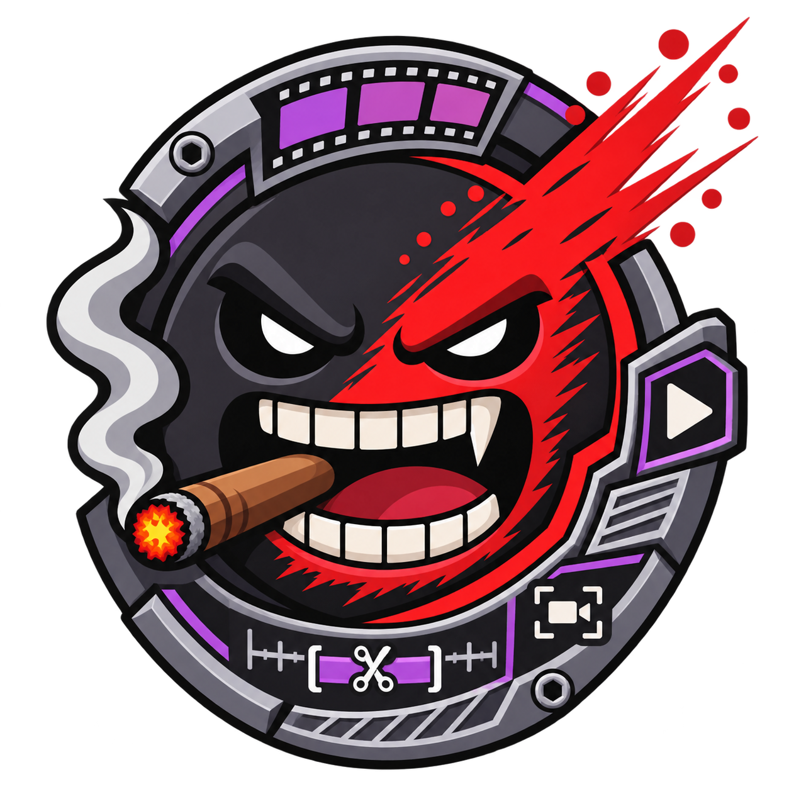
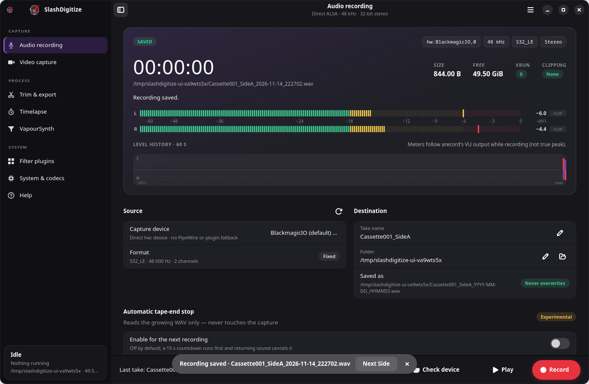

<p align="center">
  
</p>

<h1 align="center">SlashDigitize</h1>

<p align="center">
  A graphical workbench for bringing your family's old video and audio tapes into the digital world.
</p>

<p align="center">
  <a href="https://github.com/slashmad/SlashDigitize/releases/latest">Download</a> ·
  <a href="#quick-start">Quick start</a> ·
  <a href="https://github.com/slashmad/SlashDigitize/issues">Report a problem</a>
</p>


After moving from Windows to Fedora, I missed this kind of application. Linux already has
powerful tools for recording and processing video and audio, but much of that power lives in
the terminal. I wanted a graphical interface around those tools so I could spend my time
digitizing my family's old tapes instead of assembling command lines.

SlashDigitize is the updated, combined successor to my
[SlashmadFFmpegGUI](https://github.com/slashmad/SlashmadFFmpegGUI) and
[slashmad-arecordgui](https://github.com/slashmad/slashmad-arecordgui) projects. It brings their
video and audio workflows into one native GTK4/libadwaita application, with a new interface
and a dedicated audio-recording page. FFmpeg, ALSA/arecord, GStreamer and VapourSynth do the
media work underneath.



> **Status:** early development, 0.1.0. Linux is the current target. The AppImage is built and
> tested on Fedora 45 x86_64; it includes the GUI and media tools. The combined application has
> automated and simulated recording tests, and its window has been checked on a real NVIDIA
> Wayland desktop. The hardware experience below comes from the predecessor applications;
> the new AppImage has not yet been qualified through full real-device recording sessions.
> Older Linux distributions, Windows and macOS are not currently supported releases.

## Background and the equipment behind it

The original recording workflows have been used for approximately:

| Material | Amount | Playback equipment |
|---|---:|---|
| VHS tapes | 50 | Panasonic NV-HS1000 |
| Audio cassettes | 20 | Nakamichi CR-3 |
| Open-reel audio tapes | 10 | Luxor MP 823 |

The capture card is a **Blackmagic Design Intensity Pro 4K**. VHS video enters through
**S-Video**, together with the corresponding audio. The same card captures the analog stereo
audio from the cassette and open-reel decks. A **Sony STR-DB840** serves as the video/audio
switcher in my setup.

**An active video signal is needed even when recording only audio with this Blackmagic
setup.** This is a capture-hardware limitation, rather than a requirement of audio files or
arecord. My workaround is to leave a DVD player on, with a disc sitting at its menu, and route
that live video signal while recording the tape deck's audio. You do not need to save video
in order to record an audio-only WAV.

These are practical experience figures from my own setup, not a compatibility list or a claim
that every tape was recorded with this new combined version.

## What it does

- **Audio recording:** direct ALSA hardware capture through arecord, 48 kHz stereo 32-bit WAV,
  a large timer, segmented L/R meters, level history, clipping and XRUN indicators, disk-space
  information and playback of completed takes. BlackmagicIO is the default when available.
- **Video capture:** FFmpeg/V4L2 capture profiles, codec and container choices, command previews
  and a GStreamer live monitor.
- **Trim & export:** preview, trim points, frame stepping and export controls for existing files.
- **Timelapse:** turn image sequences and RAW previews into video, with bounded 1080p/2160p
  output or explicit source dimensions.
- **VapourSynth:** processing presets and a batch queue, plus an optional filter/plugin page.
  Third-party filters need to be installed separately.
- **System & codecs:** inspect the encoders and hardware capabilities found on the machine.

Capture, Process and System sections keep the workflows together. Pages adapt to narrower
windows, primary actions stay at the bottom, and recording activity remains visible while you
switch pages. Closed dropdowns, number fields and sliders keep their values when you scroll
over them; the surrounding page scrolls instead.

The audio meters follow arecord's VU output. They are useful recording indicators, not a
calibrated true-peak measurement system.

## Install

Download a package from [Releases](https://github.com/slashmad/SlashDigitize/releases).

| System | File | Requirements |
|---|---|---|
| Fedora 45 x86_64 | `SlashDigitize-0.1.0-x86_64-fedora45.AppImage` | Fedora 45 / glibc 2.44 baseline; working display and capture drivers |
| Linux x86_64 / Flatpak | `SlashDigitize-0.1.0-x86_64.flatpak` | GNOME 51 runtime from Flathub; host Python/FFmpeg/ffprobe/arecord and capture drivers |

```sh
chmod +x SlashDigitize-0.1.0-x86_64-fedora45.AppImage
./SlashDigitize-0.1.0-x86_64-fedora45.AppImage
```

The package includes Python, GTK4/libadwaita/GtkSourceView, GStreamer,
**FFmpeg 9.0.2 and ffprobe**, arecord/ALSA, and base VapourSynth/vspipe. There is no need to
install those separately to try the AppImage. Kernel support, device permissions and the
matching GPU/Blackmagic drivers still come from your system. Optional VapourSynth filters
and VSRepo metadata are separate.

If FUSE mounting is unavailable, use:

```sh
./SlashDigitize-0.1.0-x86_64-fedora45.AppImage --appimage-extract-and-run
```

A checksum and component inventory accompany the release. This build deliberately targets
Fedora 45; an AppImage built there is not automatically compatible with older distributions.
It does not install itself or change your drivers.

### Flatpak

Install the downloaded single-file bundle and run it:

```sh
flatpak install --user ./SlashDigitize-0.1.0-x86_64.flatpak
flatpak run se.slashmad.SlashDigitize
```

The bundle points to Flathub for the shared **GNOME 51** runtime. It is a direct
release download, not a Flathub listing, and it does not contain the runtime itself.
The GUI and preview libraries run inside Flatpak; media commands use the host's
`/usr/bin/python3`, FFmpeg, ffprobe and arecord through the existing host helper.
Install those tools on the host, along with any optional VapourSynth/vspipe filters
you use. This edition does not include the AppImage's bundled FFmpeg installation.

Capture workflows need device and file access, and the package grants host-tool
execution for that purpose. Normal Stop still signals the host recorder and waits
for file finalization. A standalone `.flatpak` download has no automatic update
repository; install a newer release bundle when one becomes available.

## Quick start

1. Connect the deck and capture hardware. With the Blackmagic setup described above, provide
   an active video signal before attempting audio-only capture.
2. Open **Audio recording** or **Video capture**, select the device and choose a destination.
3. Check the signal and levels before starting a long take. Device checks and live monitoring
   are explicit actions; opening the app does not start recording.
4. Press **Record**, then **Stop** when the take is complete. Let finalization finish before
   closing. After a successful audio take, **Next Side** prepares the following side.
5. Play back and inspect the result. In particular, check XRUNs, clipping and audio/video sync
   before treating a transfer as finished.

F9 toggles the sidebar, Alt+1…8 switches workflows, and Ctrl+R starts/stops audio recording
only while the audio page is selected.

## Recording behavior

Audio recording uses one direct arecord process targeting an explicit `hw:*` ALSA device.
There is no automatic PipeWire/PulseAudio/JACK fallback, and existing destination files are
refused. Audio capture/probing and video capture/monitoring cannot acquire capture devices
at the same time.

Stop sends SIGINT asynchronously and waits for the recorder to finalize the WAV. Normal
window Close and application Quit are protected while registered jobs are active; the app
does not silently force-kill a recording after a timeout.

Automatic tape-end detection is experimental and off by default. It observes the growing WAV
without changing it, and requires prior activity, sustained quiet and a cancelable countdown.
Quiet passages can occur within a tape: test the settings on your own material.

XRUN recovery keeps the recorder running but cannot restore missing samples. A file with
XRUNs needs review; a finished WAV does not by itself establish a lossless transfer.

## Build and run from source

Use Python 3.12+ and native PyGObject/Cairo, GTK4 4.16+, libadwaita 1.8+ and GtkSourceView 5.
On Fedora, the packages include `python3-gobject`, `gtk4`, `libadwaita`, `gtksourceview5`,
`alsa-utils`, FFmpeg/ffprobe, `gstreamer1`, `gstreamer1-plugins-base`,
`gstreamer1-plugins-good` and `gstreamer1-plugin-gtk4`. Codec availability depends on the
installed media builds. VapourSynth/vspipe and processing filters are optional.
Use the system Python with GI support rather than replacing it with arbitrary pip packages.

```sh
PYTHONPATH=src python3 -m slashdigitize
PYTHONPATH=src python3 -B -m unittest discover -s tests -v
python3 -B scripts/smoke.py
python3 -B scripts/build.py --out artifacts/native --rpm
```

Builds need setuptools 77+; the GUI smoke test needs Weston. The smoke test uses a private
display, simulated devices and a fake WAV recorder. It opens no capture hardware.

The GitHub Actions workflow (`.github/workflows/ci.yml`) runs the unit tests, the headless
Weston UI smoke test and the wheel/sdist/RPM build in a Fedora 45 container on every push and
pull request.

The [AppImage recipe](packaging/appimage/README.md) documents its locked runtime, build and
payload verification. The native RPM uses system dependencies. Build the GNOME 51
Flatpak with an installed matching SDK/runtime:

```sh
python3 -B scripts/build.py --flatpak --out artifacts/flatpak
```

The helper exports a `.flatpak` bundle, checksum and build record. It does not
download SDKs/runtimes or install the application. Flatpak preserves the host-media
execution policy described above.

## How it was tested

The 58-test suite covers recording logic, device parsing, job ownership, auto-stop and the
GTK control adapters. Private-display checks exercise all eight workflows, 76 scroll-protected
controls, Close/Quit guards, asynchronous stop and a finalized simulated WAV.

The extracted AppImage also passes synthetic FFmpeg encoding/ffprobe, GStreamer decoding,
base VapourSynth frame/vspipe checks, font/icon and sandboxed image-loader checks. Normal FUSE
startup and extraction fallback are tested. A separate read-only root test runs the payload
without host Python, GTK or media libraries.

Real tape capture, playback quality, GPU encoding, long sessions, physical input and
accessibility need further qualification in the combined application. See
[validation](docs/VALIDATION.md), [architecture](docs/ARCHITECTURE.md) and
[portability](docs/PORTABILITY.md) for the tested scope.

## Origin and license

**GPL-3.0-or-later.** See [LICENSE](LICENSE). Imported code retains its author/license origin;
[SOURCE_IMPORT.json](SOURCE_IMPORT.json) records the predecessor revisions and original file
hashes. The import included working-copy changes as well as committed source. The SlashDigitize
icon is the new SlashmadFFmpegGUI icon, retained unchanged.

## Support

Like SlashDigitize? Buy me a beer 🍺

[](https://github.com/sponsors/slashmad)
[](https://ko-fi.com/slashmad)
[](https://liberapay.com/slashmad/)
